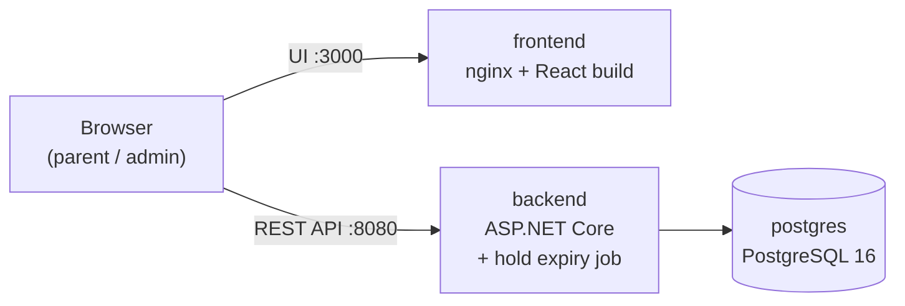

# School Admission System

First-come, first-served online school admission with time-limited seat holds.


School administrators create classes, where each class/shift (for example "Class 6 - Morning Shift") is its own
admission option with its own seat limit. Parents identify a student by the 17-digit birth registration number, apply
for a class, get a seat held for a limited time, and confirm admission by a simulated payment before the hold expires.
Unpaid holds expire and their seats return to the pool. Seats are never oversold, even under many simultaneous
applications.

## Table of contents

- [Features](#features)
- [Tech stack](#tech-stack)
- [Quick start](#quick-start)
- [Using the application](#using-the-application)
- [Configuration](#configuration)
- [API reference](#api-reference)
- [How it works](#how-it-works)
- [Running the tests](#running-the-tests)
- [Local development](#local-development)
- [Project structure](#project-structure)
- [Further documentation](#further-documentation)

## Features

**Admin dashboard** (`/admin`)

- Create classes with a name and seat count, validated in the browser and on the server (unique names, 1–10,000
  seats).
- Totals across all classes: total, on hold, confirmed and available seats.
- Per-class table with seat counts, an occupancy bar and a Full / Few seats left / Open status, refreshed live.

**Parent portal** (`/`, `/applications`)

- Enter the student's 17-digit birth registration number once; it is remembered on the device and can be changed.
- Browse classes with live seat availability and apply to reserve a seat.
- Live countdown for the reserved seat, simulated payment to confirm admission, and cancellation to release the seat.
- When time runs out the application shows as expired immediately and payment is disabled.
- "My applications" lists every application of the student with its status (`HELD`, `CONFIRMED`, `EXPIRED`,
  `CANCELLED`) and dates.

**Reliability**

- No overbooking under concurrent load, enforced by PostgreSQL row locks and constraints, also across several backend
  instances.
- One active application per student per class, enforced by a database index.
- Expired holds release their seats on time; a background job keeps the stored status up to date.
- Clear JSON errors with stable error codes, translated into friendly messages in the UI.

## Tech stack

| Part | Technology |
|---|---|
| Backend | ASP.NET Core Web API on .NET 9, EF Core 9 with Npgsql, FluentValidation |
| Database | PostgreSQL 16 |
| Frontend | React 19, TypeScript, Vite, Tailwind CSS, shadcn/ui (Base UI), TanStack Query, React Router, React Hook Form + zod |
| Tests | xUnit + Testcontainers against real PostgreSQL (backend), Vitest + React Testing Library (frontend) |
| Runtime | Docker Compose: `postgres`, `backend`, `frontend` (nginx) |

## Quick start

### Prerequisites

- Docker with Docker Compose v2. Nothing else needs to be installed.
- Ports `3000` and `8080` free on the host.

### Run

```bash
git clone https://github.com/HasnathAhmedTamim/school-admission-system.git
cd school-admission-system
docker compose up
```

The first run builds the backend and frontend images, which takes a few minutes. Then open:

| What | URL |
|---|---|
| Parent portal (apply, pay, cancel) | http://localhost:3000 |
| Parent's applications | http://localhost:3000/applications |
| Admin dashboard (create and monitor classes) | http://localhost:3000/admin |
| Backend API | http://localhost:8080 |
| Backend health check | http://localhost:8080/health |

The backend applies database migrations automatically on startup (retrying while PostgreSQL is starting), so no manual
database step is needed. Data is stored in the named Docker volume `postgres-data`
(`school-admission_postgres-data`) and survives `docker compose down` / `up` and container restarts.

### Useful commands

```bash
docker compose up -d --build    # rebuild after code changes, run in the background
docker compose logs -f backend  # follow backend logs
docker compose down             # stop; data is kept
docker compose down -v          # stop and DELETE all data (removes the volume)
```

## Using the application

1. Open http://localhost:3000/admin, click **New class** and create a class, e.g. `Class 6 - Morning Shift` with 120
   seats.
2. Open http://localhost:3000, enter a 17-digit birth registration number (e.g. `20152691234567801`) and click
   **Continue**.
3. Click **Apply and reserve seat** on a class. The application page opens with a countdown (10 minutes by default).
4. Click **Pay admission fee** → **Pay and confirm** to confirm admission, or **Cancel application** to release the
   seat.
5. If the countdown reaches zero, the page shows **Reservation expired**, payment is disabled and the seat is
   released.
6. **My applications** lists all of the student's applications and their current status. The admin dashboard shows
   the seat counts change as this happens.

To see expiry quickly, restart the backend with a short hold duration:

```bash
HOLD_DURATION_SECONDS=60 docker compose up -d --build backend          # bash
$env:HOLD_DURATION_SECONDS=60; docker compose up -d --build backend    # PowerShell
```

## Configuration

`docker compose up` works without any configuration. To override defaults, copy `.env.example` to `.env` (read
automatically by Docker Compose) or set the variables in the shell.

| Variable | Default | Used by | Purpose |
|---|---|---|---|
| `POSTGRES_DB` | `school_admission` | postgres, backend | Database name |
| `POSTGRES_USER` | `postgres` | postgres, backend | Database user |
| `POSTGRES_PASSWORD` | `postgres` | postgres, backend | Database password (local development default only) |
| `ConnectionStrings__DefaultConnection` | built by compose from the `POSTGRES_*` values | backend | PostgreSQL connection string. Required when running the backend outside Docker. |
| `HOLD_DURATION_SECONDS` | `600` | backend | How long a seat is held before it expires. Must be a positive whole number; the backend refuses to start otherwise. |
| `ASPNETCORE_ENVIRONMENT` | `Production` | backend | ASP.NET Core environment |
| `VITE_API_BASE_URL` | `http://localhost:8080` | frontend | Backend URL used **by the browser**, so it must be reachable from the user's machine (not the `backend` service name). |

`VITE_API_BASE_URL` is applied when the frontend container starts (it writes `/config.js`), so changing it only needs
a container restart, not an image rebuild. For `npm run dev` / `npm run build` outside Docker it is read from the
environment or a `frontend/.env` file in the usual Vite way.

## API reference

Base URL: `http://localhost:8080`. All bodies are JSON and all timestamps are UTC (ISO 8601). IDs are UUIDs.
Parent operations identify the student with the header `X-Student-Id: <17-digit birth registration number>`.

### Endpoints

| Method | Path | `X-Student-Id` | Success | Main errors |
|---|---|---|---|---|
| `POST` | `/classes` | – | `201` class with seat stats | `400` invalid name/seats, `409` `CLASS_NAME_TAKEN` |
| `GET` | `/classes` | – | `200` list of classes with seat stats | – |
| `GET` | `/classes/{classId}` | – | `200` class with seat stats | `404` `CLASS_NOT_FOUND` |
| `POST` | `/classes/{classId}/holds` | required | `201` hold (`HELD`, `expiresAt`) | `400` missing/invalid ID, `404`, `409` `NO_SEATS_AVAILABLE` / `ALREADY_APPLIED` / `ALREADY_ADMITTED` |
| `GET` | `/holds/{holdId}` | optional | `200` hold with current status | `400` invalid ID format (if header sent), `403` `NOT_YOUR_APPLICATION` (if header sent), `404` |
| `POST` | `/holds/{holdId}/confirm` | required | `200` `{ holdId, classId, status: "CONFIRMED", confirmedAt }` (repeatable) | `400` missing/invalid ID, `403`, `404`, `409` `HOLD_EXPIRED` / `HOLD_CANCELLED` |
| `DELETE` | `/holds/{holdId}` | required | `204` (repeatable) | `400` missing/invalid ID, `403`, `404`, `409` `ADMISSION_ALREADY_CONFIRMED` / `HOLD_EXPIRED` |
| `GET` | `/me/holds` | required | `200` the student's holds, newest first, with `className` | `400` missing/invalid ID |
| `GET` | `/health` | – | `200` `{ "status": "healthy" }` | `503` if the database is unreachable |

### Examples

Create a class:

```bash
curl -X POST http://localhost:8080/classes \
  -H "Content-Type: application/json" \
  -d '{ "name": "Class 6 - Morning Shift", "totalSeats": 120 }'
```

Apply for a class as a student:

```bash
curl -X POST http://localhost:8080/classes/{classId}/holds \
  -H "X-Student-Id: 20152691234567801"
```

Class with seat statistics:

```json
{
  "id": "0193f0c2-…",
  "name": "Class 6 - Morning Shift",
  "totalSeats": 120,
  "heldSeats": 3,
  "confirmedSeats": 10,
  "availableSeats": 107,
  "createdAt": "2026-11-09T08:00:00Z"
}
```

Hold, as returned by `GET /holds/{holdId}` and `GET /me/holds`. `POST /classes/{classId}/holds` returns `holdId`,
`classId`, `className`, `studentId`, `status`, `expiresAt` and `createdAt` (no `confirmedAt`/`cancelledAt`).

```json
{
  "holdId": "0193f0c3-…",
  "classId": "0193f0c2-…",
  "className": "Class 6 - Morning Shift",
  "status": "HELD",
  "expiresAt": "2026-11-09T08:10:00Z",
  "createdAt": "2026-11-09T08:00:00Z",
  "confirmedAt": null,
  "cancelledAt": null
}
```

### Hold statuses

| Status | Meaning |
|---|---|
| `HELD` | Seat reserved, waiting for payment until `expiresAt` |
| `CONFIRMED` | Admission fee paid; the seat belongs to the student |
| `EXPIRED` | Not paid in time; the seat was released |
| `CANCELLED` | Cancelled by the parent; the seat was released |

A `HELD` hold past its `expiresAt` is reported as `EXPIRED` immediately, and its seat is free immediately, even before
the background job stores the new status.

### Errors

Every error from the API's endpoints uses the same shape, with `errors` only present for field validation:

```json
{ "error": "VALIDATION_FAILED", "message": "Total seats must be a whole number between 1 and 10000.", "errors": { "totalSeats": ["…"] } }
```

| Status | Error codes |
|---|---|
| `400` | `VALIDATION_FAILED`, `INVALID_REQUEST`, `BAD_REQUEST`, `STUDENT_ID_REQUIRED`, `INVALID_STUDENT_ID` |
| `403` | `NOT_YOUR_APPLICATION` |
| `404` | `CLASS_NOT_FOUND`, `HOLD_NOT_FOUND` |
| `409` | `CLASS_NAME_TAKEN`, `NO_SEATS_AVAILABLE`, `ALREADY_APPLIED`, `ALREADY_ADMITTED`, `HOLD_EXPIRED`, `HOLD_CANCELLED`, `ADMISSION_ALREADY_CONFIRMED` |
| `500` | `INTERNAL_ERROR` |
| `503` | `SERVICE_BUSY` (database temporarily unavailable or busy; safe to retry) |

## How it works



The React app is served by nginx and calls the API directly from the browser. The backend follows a layered
structure: API (controllers, error handling), Application (use cases, validation), Core (entities and hold rules) and
Infrastructure (EF Core, repositories, background job).

### How overbooking is prevented

- Applying for a class runs in one transaction that locks the class row (`SELECT … FOR UPDATE`), counts confirmed
  holds plus unexpired held holds, and inserts the new hold only if a seat is left. Applications for the same class
  are therefore handled one at a time, in arrival order, across any number of backend instances.
- Confirming or cancelling locks the class row (shared) and then the hold row, and checks expiry using the time
  *after* the locks are acquired, so a delayed confirmation can never revive a hold whose seat was already given away.
- A partial unique index on `(class_id, student_id)` for `HELD`/`CONFIRMED` rows enforces one active application per
  student per class at the database level. Check constraints enforce valid statuses and student IDs.
- A background service marks overdue holds `EXPIRED` every 5 seconds using `FOR UPDATE SKIP LOCKED`, so several
  backend instances can run it at the same time without conflicts.
- Seat statistics are calculated from the hold rows on every request rather than stored as counters, so they cannot
  drift out of sync.

## Running the tests

### Backend (xUnit, 47 tests)

The tests run against a real PostgreSQL database, never an in-memory substitute. They cover the domain rules, the
class and hold endpoints, expiry, persistence and concurrency, including the required concurrency tests (for example 100 simultaneous
applications for 10 seats, two API instances sharing one database, and a confirmation delayed past expiry while
another student applies).

With Docker only, using the compose PostgreSQL (the tests use a separate `school_admission_tests` database that is
recreated on every run, so application data is not touched):

```bash
docker compose --profile test run --rm --build backend-tests
```

With the .NET 9 SDK installed (Testcontainers starts a temporary PostgreSQL container, so Docker must be running):

```bash
cd backend
dotnet test
```

To use an existing PostgreSQL server instead of Testcontainers, set `TEST_DATABASE_CONNECTION` to a connection string.
The database named in it is dropped and recreated by the tests.

### Frontend (Vitest + React Testing Library, 29 tests)

With Docker only:

```bash
docker compose --profile test run --rm --build frontend-tests
```

With Node.js 24 installed:

```bash
cd frontend
npm ci
npm test            # run once
npm run test:watch  # watch mode
```

Other frontend checks: `npm run typecheck`, `npm run lint`, `npm run build`.

## Local development

Running without Docker is optional. The compose PostgreSQL does not publish port 5432 to the host, so the backend needs
its own PostgreSQL server.

Backend (needs the .NET 9 SDK):

```bash
cd backend
# bash
ConnectionStrings__DefaultConnection="Host=localhost;Port=5432;Database=school_admission;Username=postgres;Password=postgres" \
ASPNETCORE_URLS=http://localhost:8080 \
dotnet run --project src/SchoolAdmission.API
```

```powershell
cd backend
# PowerShell
$env:ConnectionStrings__DefaultConnection="Host=localhost;Port=5432;Database=school_admission;Username=postgres;Password=postgres"
$env:ASPNETCORE_URLS="http://localhost:8080"
dotnet run --project src/SchoolAdmission.API
```

Frontend (needs Node.js 24; the dev server uses port 3000, so stop the Docker frontend first):

```bash
cd frontend
npm ci
npm run dev
```

## Project structure

```
backend/
  src/SchoolAdmission.API             controllers, error handling, startup
  src/SchoolAdmission.Application     use cases (class and admission services), validation, DTOs
  src/SchoolAdmission.Core            entities and hold state rules
  src/SchoolAdmission.Infrastructure  EF Core, migrations, repositories, hold expiry background service
  tests/SchoolAdmission.Tests         domain, API, expiry, persistence and concurrency tests
  Dockerfile                          runtime and test images
frontend/
  src/pages                           parent and admin pages
  src/features                        classes, admissions and dashboard components, hooks and API calls
  src/components                      shared components and shadcn/ui primitives
  Dockerfile, nginx.conf              runtime (nginx) and test images
docker-compose.yml                    postgres, backend, frontend; backend-tests and frontend-tests (profile "test")
.env.example                          optional configuration overrides
ASSUMPTIONS.md                        decisions where the brief was not explicit
AI_USAGE.md                           how AI tools were used
```

## Further documentation

- [ASSUMPTIONS.md](ASSUMPTIONS.md): decisions made where the assignment was not explicit, and why.
- [AI_USAGE.md](AI_USAGE.md): which AI tools were used, for what, where they made mistakes and how those were caught.
